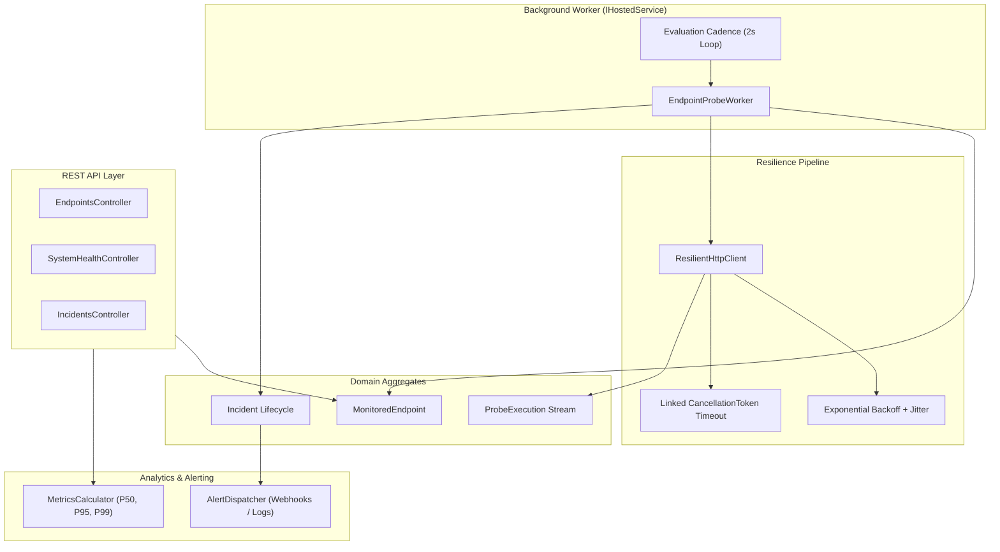

# IntegrationWatch — API & Webhook Resilience Monitoring Platform

[](#)
[](#)
[](#)
[](LICENSE)

A high-performance synthetic monitoring and integration resilience service designed for modern cloud architectures. Engineered with **C# / .NET 8**, **Polly resilience patterns**, **Background Services (`IHostedService`)**, and **RFC 7807 ProblemDetails**.

---

## 1. Business Problem
Modern distributed SaaS applications depend heavily on external webhooks and third-party APIs (Stripe, SendGrid, Twilio, ERPs). When external APIs degrade or fail silently:
- Customers report checkout errors before engineering teams notice.
- Transient network glitches cause false-alarm alerts and on-call burnout.
- Engineering leads lack visibility into true latency distributions (P95 and P99 percentiles).

**IntegrationWatch** continuously runs synthetic probes, mitigates transient blips via exponential backoff retries, calculates statistical latency percentiles, and manages incident state transitions with automated resolution upon service recovery.

---

## 2. Intended Users
- **Backend & Platform Engineers:** Needing synthetic telemetry across critical external microservices and payment gateways.
- **Site Reliability Engineers (SREs):** Monitoring SLA/SLO uptime and P95/P99 latency trends.
- **Freelance & Contract Engineers:** Delivering reliable background worker services and resilient integrations for client businesses.

---

## 3. Major Capabilities

- **Synthetic Probe Scheduler:** Background worker running non-blocking scheduled HTTP probes.
- **Resilience Engine:** Exponential backoff with jitter and linked cancellation token timeouts.
- **Consecutive Failure Thresholds:** 3-stage health progression (`Healthy` → `Degraded` → `Unhealthy`).
- **Statistical Latency Telemetry:** Real-time computation of P50 (median), P95, and P99 response time percentiles.
- **Incident Lifecycle Management:** Automatically triggers incidents upon threshold breach and auto-resolves when the endpoint recovers.
- **Distributed Correlation Tracking:** Injects `X-Correlation-ID` across every probe request and error response.
- **RFC 7807 ProblemDetails:** Uniform JSON error formats for all API exceptions.

---

## 4. Architecture Overview



---

## 5. Technology Stack
- **Runtime:** .NET 8 LTS (C# 12)
- **Web API:** ASP.NET Core Web API with Controllers & Minimal APIs
- **Background Processing:** `BackgroundService` (`IHostedService`) with `IServiceScopeFactory` scoped resolution
- **HTTP Client:** `IHttpClientFactory` with high-precision Stopwatch timing
- **Testing:** MSTest 3.1, Moq 4.18
- **Containerization:** Docker multi-stage build & Docker Compose

---

## 6. Prerequisites
- .NET 8 SDK or newer (`dotnet --version`)
- Docker (optional)

---

## 7. Quickstart & Local Execution

### Step 1: Run Automated Tests
```powershell
dotnet test tests/IntegrationWatch.Tests/IntegrationWatch.Tests.csproj
```
*(All 8 unit and service tests pass in under 500 ms).*

### Step 2: Run the API & Background Worker
```powershell
cd src/IntegrationWatch.Api
dotnet run --launch-profile "http"
```
The service will start listening on `http://localhost:5050`.

### Step 3: Inspect Telemetry
- System Summary: `http://localhost:5050/api/health-summary`
- Monitored Endpoints: `http://localhost:5050/api/endpoints`
- Active Incidents: `http://localhost:5050/api/incidents/active`

---

## 8. Automated Testing Results
```text
Test run for IntegrationWatch.Tests.dll (.NETCoreApp,Version=v8.0)
Passed!  - Failed: 0, Passed: 8, Skipped: 0, Total: 8, Duration: 453 ms
```
- Verified failure threshold transitions (`Healthy` → `Degraded` → `Unhealthy`).
- Verified percentile mathematics (P50, P95, P99).
- Verified automatic incident creation and alert dispatch on threshold breach.
- Verified automatic incident recovery when endpoints heal.

---

## 9. License & Attribution
Designed and built by **Rashad** ([@RASHA2702](https://github.com/RASHA2702)). Licensed under the **MIT License**.
