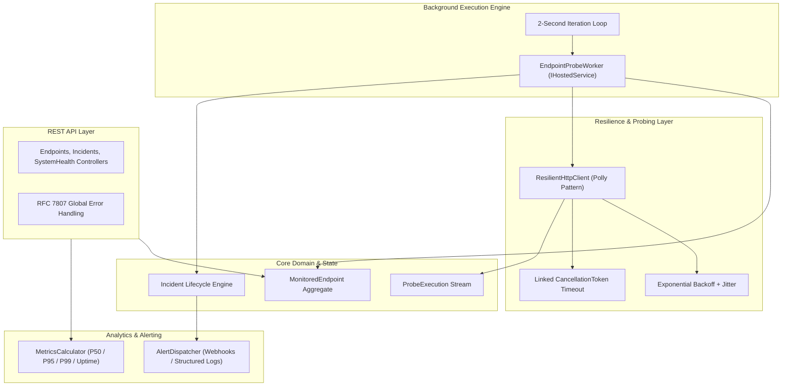

# IntegrationWatch — Architecture & System Design

## 1. System Overview
IntegrationWatch is a resilient API and webhook monitoring service engineered for high availability and low overhead.

---

## 2. Core Components

1. **`EndpointProbeWorker` (`IHostedService`):**
   - Implements ASP.NET Core `BackgroundService` pattern.
   - Creates an `IServiceScope` per iteration loop, preventing captive dependency leaks while safely resolving scoped repositories.
   - Evaluates each endpoint's `IntervalSeconds` schedule.
   - Detects consecutive failures exceeding the configured threshold and triggers an `Incident`.
   - Automatically detects recovery and transitions open incidents to `Resolved`.

2. **`ResilientHttpClient`:**
   - Wraps standard `HttpClient` with retry policies, exponential backoff with randomized jitter (`Math.Pow(2, attempt) * 100 + jitter`), and precise stopwatches.
   - Injects correlation tracking (`X-Correlation-ID`) into every probe request.

3. **`MetricsCalculator`:**
   - Mathematically computes percentile latencies:
     - Median (P50)
     - 95th Percentile (P95)
     - 99th Percentile (P99)
   - Computes rolling uptime percentages across execution history.
